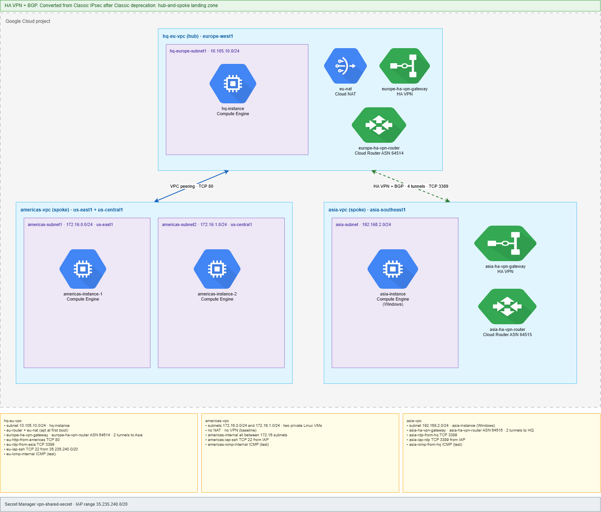
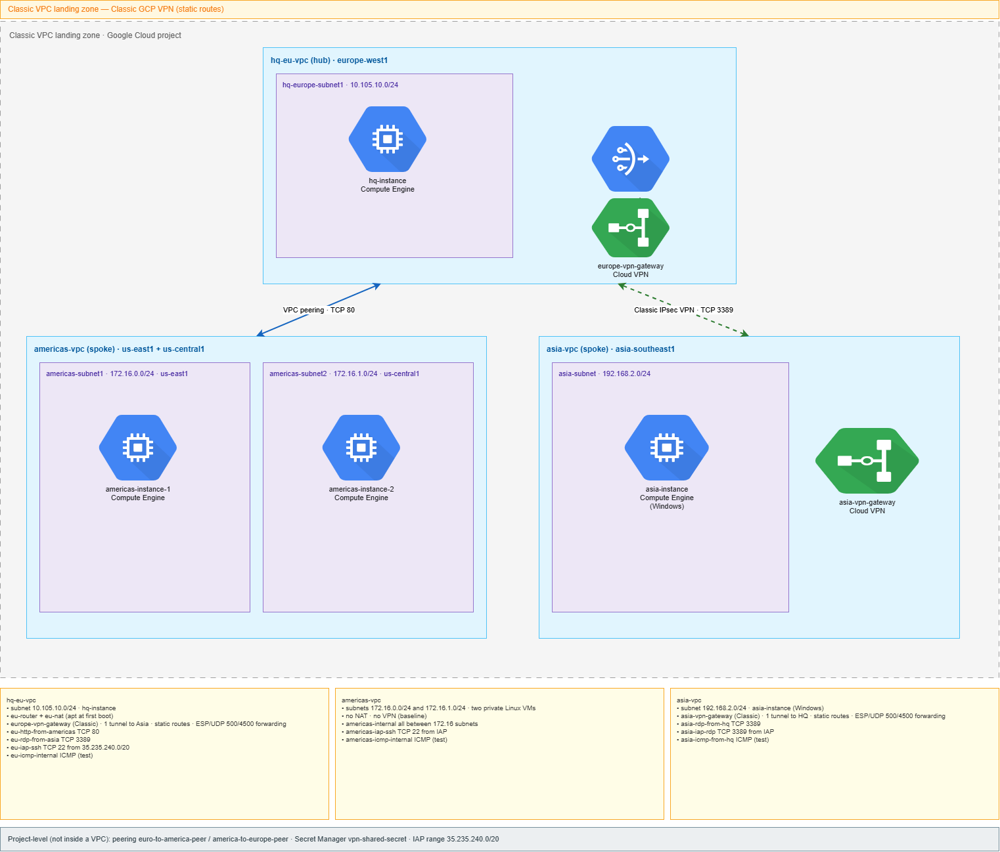

# International Telecom — Global Landing Zone Architecture

An interactive visualization of a global cloud architecture I designed and implemented. It shows how a private network connects distributed business operations while keeping regional security boundaries intact.

The working design is **HA VPN + BGP** between Europe and Asia-Pacific, with **VPC Network Peering** between the Americas and Europe. Classic IPsec VPN was the original concept and is kept here only as a comparison.

## Business Problem

A global organization needs workloads in the Americas, Europe, and Asia-Pacific to communicate without exposing its internal systems directly to the public internet.

The design also needs to account for an important operational reality: not every region requires the same type of connectivity. Some workloads need routine private application access, while others require a more tightly controlled path with explicitly permitted traffic.

The objective was therefore to create an architecture that provides:

- Private connectivity between geographically distributed environments
- A centralized European hub with regional spokes
- Different connectivity methods based on regional requirements
- Explicit traffic boundaries between environments
- No direct public ingress to application workloads
- A design that can be understood and validated visually

## Architecture Approach

I designed the environment as a **hub-and-spoke global network** using three Google Cloud VPCs.

**Europe** serves as the central hub. The **Americas** and **Asia-Pacific** environments operate as spokes, with each connectivity path selected according to its requirements rather than applying one networking method everywhere.

### Americas → Europe

The Americas environment contains workloads in both `us-central1` and `us-east1`.

Because both environments operate within Google Cloud and require private application connectivity, the Americas VPC connects directly to the European hub through **VPC Network Peering**.

The implemented application path allows the Americas environment to reach the European workload over **HTTP (TCP 80)** while keeping the communication on private network paths.

### Europe → Asia-Pacific

The Asia-Pacific workload resides in `asia-southeast1`.

Instead of extending the same peering model to this environment, Asia-Pacific connects to the European hub through **HA VPN with BGP**: dual HA gateways, Cloud Routers (ASN 64514 / 64515), and four tunnels. Traffic between the environments stays on an encrypted path and is controlled explicitly.

The implemented management path permits **Europe → Asia-Pacific RDP (TCP 3389)**, while selected Asia-Pacific initiated traffic toward the European environment is denied.

## Architecture decision

The original concept used **Classic IPsec VPN** with static routes: one gateway interface and one tunnel per side. Classic VPN is deprecated.

The implemented design accepts the higher cost of HA VPN and BGP in exchange for dual interfaces, redundant tunnels, and dynamic routing. That is a deliberate trade against a cheaper Classic / static implementation.

| | Classic (original concept) | HA VPN + BGP (working design) |
| --- | --- | --- |
| Asia–Europe interconnect | Classic IPsec, static routes | HA VPN, Cloud Router BGP |
| Gateways | One interface per side | Two interfaces per side |
| Tunnels | One per side | Four tunnels |
| Routing | Static | BGP ASN 64514 / 64515 |

**Working design:**

**Original concept (comparison only):**

## Security Model

The architecture follows a private-by-default approach.

Application VM interfaces do not require public IP addresses for inbound access. The European environment uses Cloud NAT where outbound internet access is required for tasks such as software installation and updates.

Firewall policy is based on required traffic flows rather than broad regional access. The design intentionally avoids direct spoke-to-spoke connectivity between the Americas and Asia-Pacific environments.

This results in a simple trust model:

**Americas → European Hub ← Asia-Pacific**

Each spoke has a defined relationship with the hub without automatically gaining connectivity to the other spoke.

## Architecture at a Glance

| Environment | Region | Role | Connectivity |
| --- | --- | --- | --- |
| Americas | `us-central1`, `us-east1` | Spoke | VPC Network Peering |
| Europe | `europe-west1` | Hub | Central connectivity point |
| Asia-Pacific | `asia-southeast1` | Spoke | HA VPN + BGP |

The interactive architecture visualization maps these cloud regions to their approximate geographic locations and demonstrates the intended traffic flows between them.

## Why This Design

The goal was not simply to connect three networks. It was to choose connectivity and security controls based on the role of each environment.

The resulting architecture demonstrates several cloud networking principles in a single design:

- Hub-and-spoke network organization
- Multi-region private connectivity
- VPC Network Peering
- HA VPN with BGP
- Controlled ingress and egress
- Regional workload isolation
- Non-transitive spoke relationships
- Infrastructure designed around explicit business traffic requirements

## Interactive Visualization

This repository includes an interactive browser-based representation of the **HA VPN + BGP** design. There is one HTML diagram, not a Classic variant.

The visualization is intentionally presented at a higher level than the underlying infrastructure implementation. It allows a reviewer to quickly understand the global topology, regional placement, connectivity methods, and security boundaries without requiring them to first interpret Terraform or individual cloud resources.

Use the **Explore Traffic Flows** controls to examine the primary application paths and security boundaries. Click a VPC window to hide it; use the top-left pills to bring it back. The peering and VPN flow paths stay on the map.

Live site: [jaycloud336.github.io/international-telecom-architecture](https://jaycloud336.github.io/international-telecom-architecture/)

## Implementation

The underlying cloud environment was implemented with infrastructure as code on Google Cloud.

This public visualization is limited to architecture and design intent. It does not include environment-specific implementation details, credentials, or other sensitive infrastructure configuration.

---

**Project focus:** Google Cloud networking · Global architecture · Hub-and-spoke design · VPC Peering · HA VPN · BGP · Private connectivity · Network security
